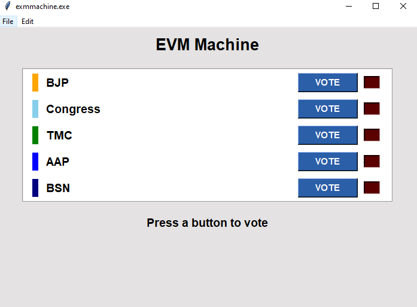
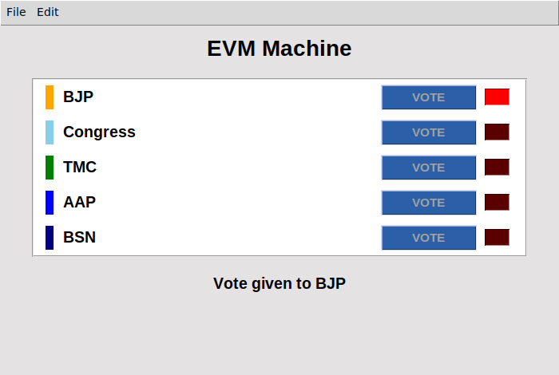

# EVM Machine 🗳️

A tiny voting machine made with Python and Tkinter. It has five buttons: BJP, Congress, TMC, AAP and BSN.

You can press any of them. It doesn't matter which one. The screen will say **"Vote given to BJP"**.

Yes, it's a joke. 😄

| Before voting | After pressing any button |
|---|---|
|  |  |

## Why did I make this?

"Vote chori" (vote theft) is all over the news right now, so I turned it into a meme project. The whole idea is one line of code: you press a button, and the vote still goes to BJP.

## What's going on right now (rough idea)

Just a quick summary as of mid-October 2026. Please read the news yourself!

- **The allegation:** The opposition says the Special Intensive Revision (SIR) of voter rolls is "vote chori", and it is demanding the resignation of Chief Election Commissioner Gyanesh Kumar.
- **Detentions:** On Oct 7, Rahul Gandhi and other INDIA bloc leaders were detained and later released. Congress then called nationwide protests on Oct 8.
- **Youth protest:** The Cockroach Janta Party (CJP) held youth-led protests at Jantar Mantar. Many protesters were detained, and the party says it will keep going until Kumar resigns.
- **Supreme Court:** On Oct 12, the INDIA bloc marched to the Supreme Court, and Rahul Gandhi and Mallikarjun Kharge filed a petition. On Oct 5, the court had refused to pass an interim order suspending Kumar.
- **What's next:** Congress has a "Vote Bachao, Desh Bachao, CEC Hatao" campaign, with rallies planned from Oct 25 to Nov 25.
- **The other side:** The BJP says Congress attacks institutions whenever decisions go against it. The ECI has earlier called such allegations baseless.

These are allegations and counter-allegations, so I'm not claiming any of it is proven.

## How it works

1. You press any party button.
2. The machine beeps, the BJP lamp turns red, and the screen shows "Vote given to BJP".
3. The buttons lock for 2 seconds, then it gets ready for the next voter.
4. **File → Show Results** shows the tally (guess who's winning).

## Run it

You need Python 3 (Tkinter comes with it) and [uv](https://github.com/astral-sh/uv).

```bash
git clone <your-repo-link>
cd evm-hack
uv run evmmachine.py
```

## Built with

- Python
- Tkinter
- A lot of free time

--- - - - - - - -
Special Thanks For Claude For This README.md file 

###### ⚠️ Disclaimer

*This project was made as a parody. All the allegations mentioned here are not entirely true, and everything was done purely for fun.*
